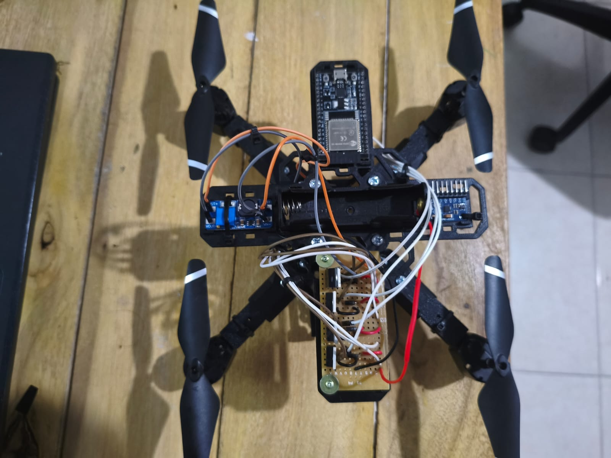
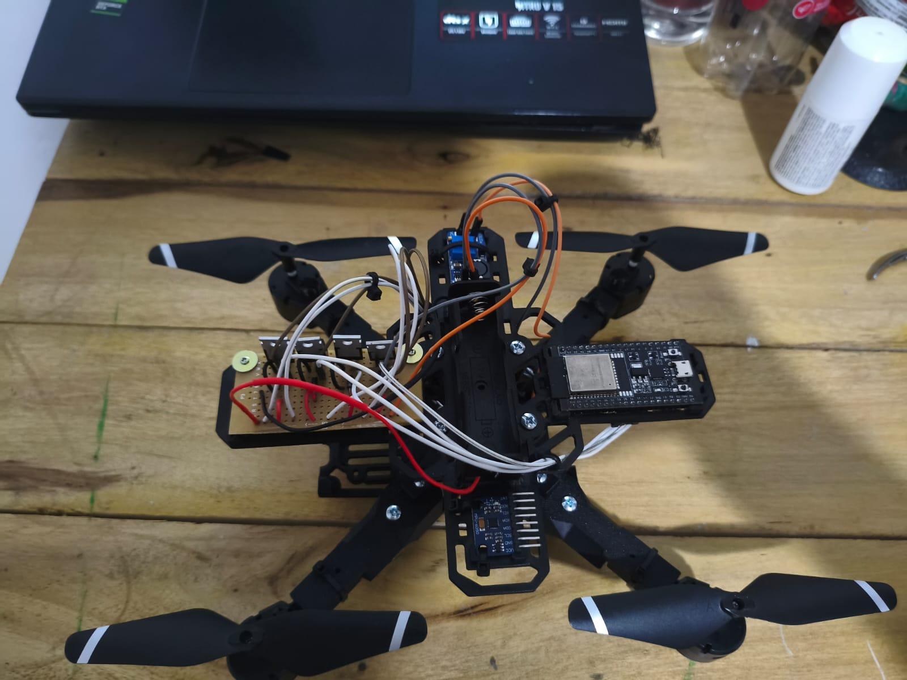
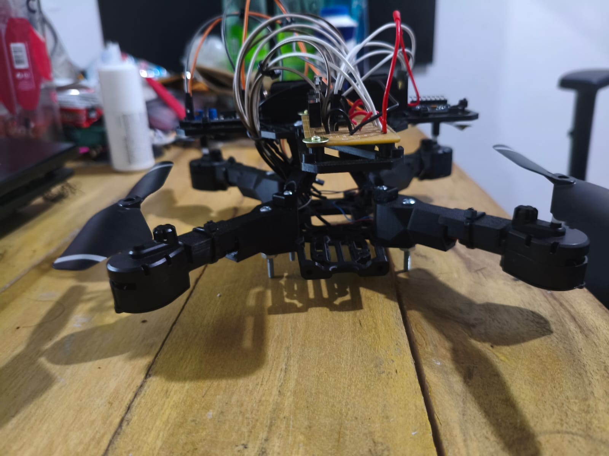
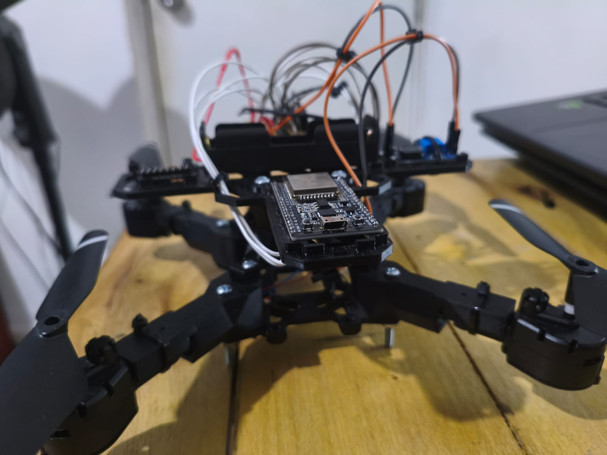
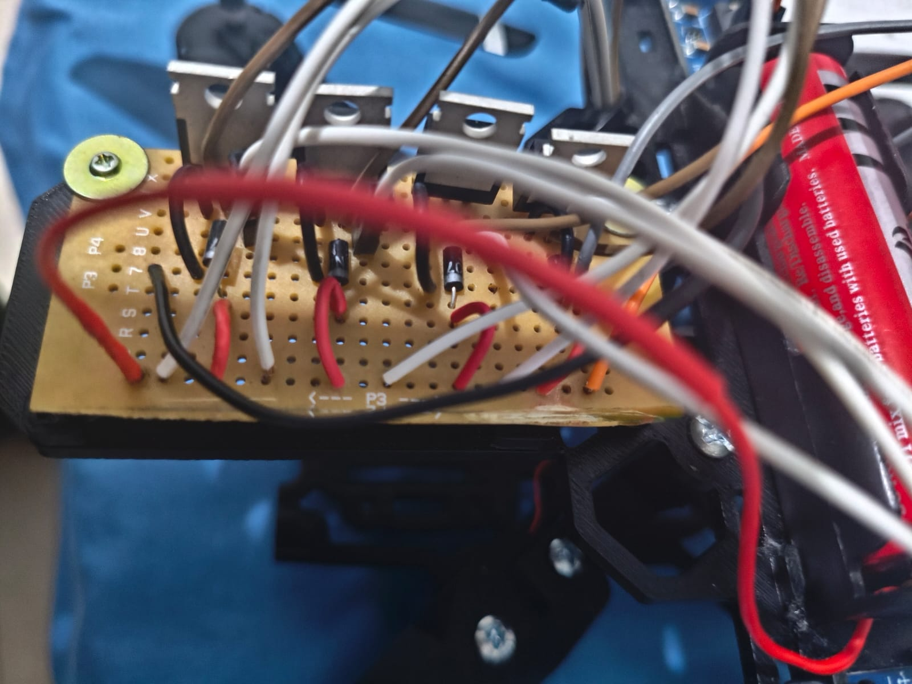
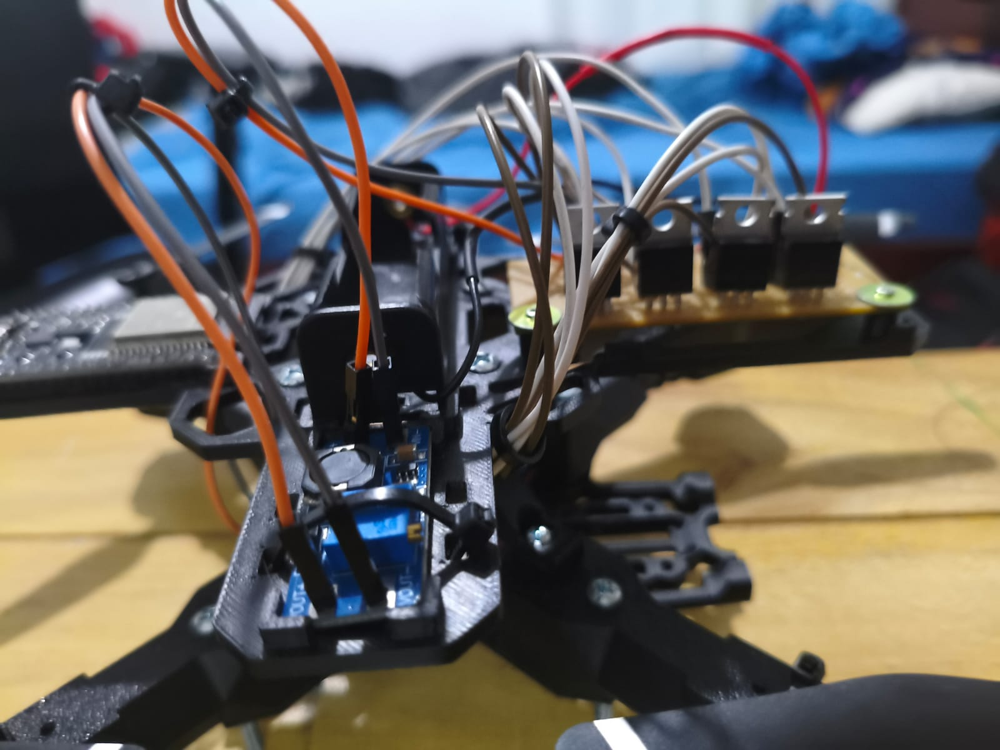
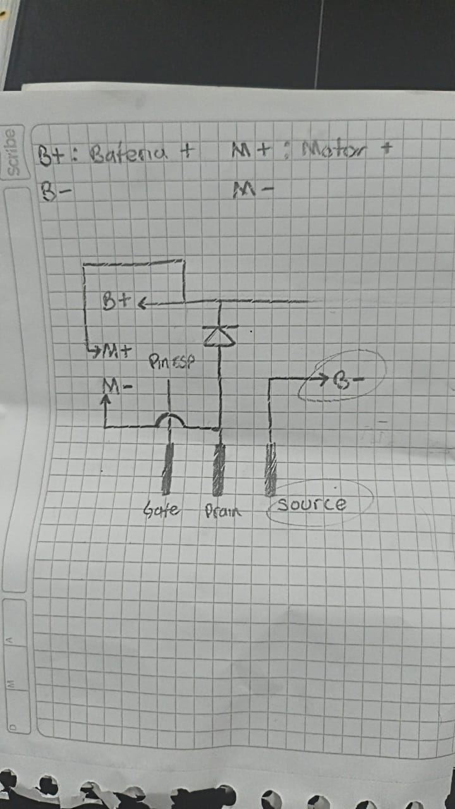

# Dron Cuadricóptero ESP32 — Plataforma Educativa Open Hardware & Software


Plataforma completa de hardware abierto y software embebido/móvil para el diseño, construcción, control Wi-Fi, control por voz **100 % offline**, visualización CAD 3D y simulación de un **dron cuadricóptero de doble nivel basado en ESP32-WROOM-32D**, desarrollado en la **Universidad de Santander (UDES)**.

<p align="center">
  
</p>

---

## Características Principales

- **Hardware 100 % replicable en ABS:** Chasis cruciforme de doble nivel compuesto por **5 piezas `.stl`**, con compensación térmica para impresión ABS (`+0.6 %` en `X/Z` en el piso superior), etapa de potencia con **4× MOSFET IRFZ44N** + diodos *flyback* en baquelita perforada y elevador **MT3608** regulado a `5.0 V`.
- **Dos ecosistemas completos e independientes:**
  - **Modo Oficial (`UDES_UAV_CONTROL`):** Control de vuelo real con sensor **MPU-6050**, filtro complementario + lazo **PID a 100 Hz**, servidor **WebSocket RFC 6455 nativo** a `50 Hz` y telemetría en tiempo real a `~33 Hz`.
  - **Modo Testeo (`UDES_MOTORES_TEST`):** Banco de pruebas sin giroscopio por **HTTP + CORS** (`/set`, `/stop`, `/seq`, `/ramp`, `/status`) para calibración segura de motores e inspección de polaridad/PWM.
- **Firmwares nativos sin librerías externas:** Escritos en C++/Arduino estándar usando únicamente paquetes del core oficial (`WiFi.h`, `Wire.h`, `WebServer.h`, `mbedtls/sha1.h`, `mbedtls/base64.h`), compatibles con **ESP32 Arduino Core 2.x y 3.x** y sin HTML pesado en `PROGMEM`.
- **Control por voz 100 % offline (`"Dron"`):** Motor **Vosk** (`vosk-model-small-es-0.42`) embebido localmente en Android + síntesis de voz masculina (`TextToSpeech`) con bloqueo nativo anti-eco (`isAudioBusy`), triple capa de seguridad contra apagado accidental en vuelo, aterrizaje suave y dos coreografías sincronizadas con **memoria de potencia previa (`preDancePower`)**.
- **Visor 3D interactivo offline (`visor-3d/`):** Escena en **Three.js** cargada desde las **5 mallas `.stl` reales**, despiece general y por módulo electrónico, inspección de circuitos 3D y acceso local sin conexión a los **4 datasheets PDF**.
- **Simulador 2D en PC (`simulador-pc/`):** Banco de pruebas de cinemática, telemetría y servidor emulador Wi-Fi en Node.js (`simulador-pc/modo-wifi.js`) antes de probar sobre el dron físico.

---

## Galería del Prototipo Físico

| Vista General | Perfil Doble Nivel | Perfil Módulo ESP32 |
| :---: | :---: | :---: |
|  |  |  |

| Placa de Potencia (4× IRFZ44N) | Elevador MT3608 (5.0 V) | Esquema Etapa MOSFET |
| :---: | :---: | :---: |
|  |  |  |

---

## Estructura del Repositorio

```text
Control Dron/
├── README.md
├── LICENSE
├── .gitignore
├── firmware/
│   ├── dron_oficial_mpu6050/
│   │   └── dron_oficial_mpu6050.ino        # Firmware vuelo real (MPU-6050 + PID 100 Hz + WebSocket :81)
│   └── dron_testeo_motores/
│       └── dron_testeo_motores.ino         # Firmware banco de pruebas (HTTP :80 sin giroscopio)
├── app-android/                            # Proyecto Capacitor 6 + Plugin Java VoskVoicePlugin + 2 flavors
│   ├── capacitor.config.json
│   ├── package.json
│   ├── www-oficial/                        # Interfaz GCS horizontal para Dron Oficial
│   ├── www-testeo/                         # Interfaz de banco y voz para Dron Testeo
│   └── android/                            # Proyecto Gradle (flavors 'oficial' y 'drontesteo' + vosk-model-es)
├── visor-3d/                               # Visor 3D offline Three.js (servidor local en puerto 3030)
│   ├── abrir-visor-3d.bat
│   ├── index.html
│   ├── servir.js
│   ├── css/
│   ├── js/
│   └── vendor/three/
├── simulador-pc/                           # Simulador 2D y emulador Wi-Fi ESP32 en Node.js
│   ├── index.html
│   └── modo-wifi.js
├── hardware/
│   ├── chasis-stl/                         # 5 piezas STL definitivas + plano SVG de verificación
│   │   ├── 01_placa-inferior.stl
│   │   ├── 02_piso-superior-abs.stl
│   │   ├── 03_brazo-motor-a.stl
│   │   ├── 04_brazo-motor-b.stl
│   │   ├── 05_columna-malla-36mm.stl
│   │   └── plano-distribucion-piso-superior.svg
│   └── datasheets/                         # Datasheets PDF locales para consulta offline
│       ├── ESP32-WROOM-32D.pdf
│       ├── IRFZ44N.pdf
│       ├── MT3608.pdf
│       └── MPU-6050.pdf
├── scripts/
│   └── compilar-apks.ps1                   # Compilación dual de APKs co-instalables hacia releases/
├── releases/                               # Salida local de APKs compilados (ignorada en Git)
│   ├── dron-oficial.apk
│   └── dron-testeo.apk
└── docs/
    ├── media/                              # 7 fotografías técnicas seleccionadas del prototipo
    └── bitacora/                           # Pedidos e informes técnicos por tramo del proyecto
        ├── 01-arquitectura-y-simulador/
        ├── 02-diseno-chasis-abs/
        ├── 03-visor-3d-y-documentacion/
        ├── 04-voz-offline-y-paquetes-finales/
        └── 05-preparacion-repositorio/
```

---

## Arquitectura de Hardware y Pinout

### Lista de Materiales (BOM)

| Componente | Especificación | Función en el Prototipo |
| :--- | :--- | :--- |
| **Microcontrolador** | ESP32-WROOM-32D (38 pines) | Wi-Fi SoftAP, control PWM, lazo PID y servidor HTTP/WebSocket |
| **Sensor IMU** | GY-521 / MPU-6050 (dirección `0x68`) | Acelerómetro + giroscopio 6-DoF por bus I2C |
| **Elevador DC-DC** | Módulo Boost MT3608 ajustado a `5.0 V` | Alimentación regulada del ESP32 desde la batería `3.7 V` |
| **Etapa de Potencia** | 4× MOSFET N-Channel IRFZ44N + 4× diodos *flyback* | Conmutación *low-side* PWM de los 4 motores sobre baquelita |
| **Batería** | 1× Celda Li-Ion 18650 (`3.7 V` nominal) | Bus principal `B+ / B−` para motores y entrada del MT3608 |
| **Actuadores** | 4× Motores DC/*coreless* con caja reductora y hélices `CW/CCW` | Propulsión en configuración cuadricóptero `X` |
| **Estructura** | 5 piezas impresas en ABS (doble nivel, columnas `36 mm`) | Alojamiento rígido de electrónica, batería y brazos |

### Tabla Exacta de Pines (`ESP32-WROOM-32D`)

| Señal / Canal | Pin ESP32 | Conexión Física | Parámetros Eléctricos / Software |
| :--- | :--- | :--- | :--- |
| **`M1_FL`** (Delantero Izquierdo, **CW**) | `GPIO 25` | Gate MOSFET canal 1 | PWM `2500 Hz`, resolución `10 bits` (`0–1023`) |
| **`M2_FR`** (Delantero Derecho, **CCW**) | `GPIO 26` | Gate MOSFET canal 2 | PWM `2500 Hz`, resolución `10 bits` (`0–1023`) |
| **`M3_RL`** (Trasero Izquierdo, **CCW**) | `GPIO 27` | Gate MOSFET canal 3 | PWM `2500 Hz`, resolución `10 bits` (`0–1023`) |
| **`M4_RR`** (Trasero Derecho, **CW**) | `GPIO 14` | Gate MOSFET canal 4 | PWM `2500 Hz`, resolución `10 bits` (`0–1023`) |
| **`I2C SDA`** (MPU-6050) | `GPIO 21` | Pin `SDA` del MPU-6050 | Bus I2C `400 kHz` / dirección `0x68` |
| **`I2C SCL`** (MPU-6050) | `GPIO 22` | Pin `SCL` del MPU-6050 | Bus I2C `400 kHz` / dirección `0x68` |
| **Alimentación IMU** | `3V3` / `GND` | `VCC` y `GND` del MPU-6050 | Regulador interno `3.3 V` del ESP32 |
| **Alimentación ESP32** | `5V / VIN` | `VOUT+` (`5.0 V`) del MT3608 | `VOUT−` unido a masa común (`GND` / `B−` / `Source`) |

> [!CAUTION]
> **Seguridad eléctrica antes de programar por USB:** Desconecta físicamente el cable proveniente de `VOUT+ (5.0 V)` del elevador **MT3608** al pin `5V/VIN` del ESP32 antes de conectar el cable micro-USB al computador, para evitar conflictos de alimentación entre el regulador Boost y el puerto USB.

### Archivos CAD (`.stl`) y Datasheets (`.pdf`)

- **Chasis 3D (`hardware/chasis-stl/`):**
  - [01_placa-inferior.stl](hardware/chasis-stl/01_placa-inferior.stl) — Base estructural inferior con escotilla aligerada
  - [02_piso-superior-abs.stl](hardware/chasis-stl/02_piso-superior-abs.stl) — Cubierta superior cruciforme con compensación ABS (`×1.006`)
  - [03_brazo-motor-a.stl](hardware/chasis-stl/03_brazo-motor-a.stl) — Brazo diagonal A (`M1_FL` / `M4_RR`)
  - [04_brazo-motor-b.stl](hardware/chasis-stl/04_brazo-motor-b.stl) — Brazo diagonal B (`M2_FR` / `M3_RL`)
  - [05_columna-malla-36mm.stl](hardware/chasis-stl/05_columna-malla-36mm.stl) — Columna separadora en V (`H = 36 mm`)
  - [plano-distribucion-piso-superior.svg](hardware/chasis-stl/plano-distribucion-piso-superior.svg) — Plano técnico 2D escala `1:1`
- **Datasheets (`hardware/datasheets/`):**
  - [ESP32-WROOM-32D.pdf](hardware/datasheets/ESP32-WROOM-32D.pdf)
  - [IRFZ44N.pdf](hardware/datasheets/IRFZ44N.pdf)
  - [MT3608.pdf](hardware/datasheets/MT3608.pdf)
  - [MPU-6050.pdf](hardware/datasheets/MPU-6050.pdf)

---

## Guía Rápida de Uso (Paquete Oficial vs. Paquete Testeo)

Ambos paquetes utilizan `applicationId` diferentes, por lo que pueden instalarse **simultáneamente en el mismo teléfono Android** sin sobrescribirse.

| Aspecto | Paquete Oficial (`Dron Oficial`) | Paquete Testeo (`Dron Testeo`) |
| :--- | :--- | :--- |
| **Firmware ESP32** | [`firmware/dron_oficial_mpu6050/dron_oficial_mpu6050.ino`](firmware/dron_oficial_mpu6050/dron_oficial_mpu6050.ino) | [`firmware/dron_testeo_motores/dron_testeo_motores.ino`](firmware/dron_testeo_motores/dron_testeo_motores.ino) |
| **Archivo APK** | `dron-oficial.apk` | `dron-testeo.apk` |
| **`applicationId`** | `com.udes.dronoficial` | `com.udes.drontesteo` |
| **Red Wi-Fi AP** | `UDES_UAV_CONTROL` (Canal `1`) | `UDES_MOTORES_TEST` (Canal `1`) |
| **Contraseña Wi-Fi** | `12345678` | `12345678` |
| **IP / Protocolo** | `192.168.4.1` · **WebSocket `ws://192.168.4.1:81`** (`50 Hz`) | `192.168.4.1` · **HTTP + CORS `http://192.168.4.1`** |
| **Control de Actitud** | MPU-6050 + Filtro Complementario + PID `100 Hz` + Modo Directo | Control manual por motor (`M1..M4`), rutinas `/seq` y `/ramp` |
| **Orientación UI** | Horizontal fija (`sensorLandscape`) | Adaptable (`unspecified`) |

### 1. Cargar el Firmware en Arduino IDE

1. Desconecta el pin `5V/VIN` del MT3608 y conecta el **ESP32** por USB.
2. Abre en **Arduino IDE** el `.ino` correspondiente (respetando su carpeta padre):
   - Vuelo con sensor: [`firmware/dron_oficial_mpu6050/dron_oficial_mpu6050.ino`](firmware/dron_oficial_mpu6050/dron_oficial_mpu6050.ino)
   - Banco de pruebas sin sensor: [`firmware/dron_testeo_motores/dron_testeo_motores.ino`](firmware/dron_testeo_motores/dron_testeo_motores.ino)
3. Selecciona la placa **ESP32 Dev Module** (compatible con ESP32 Arduino Core 2.x y 3.x; no requiere instalar librerías externas).
4. Compila y sube el código; abre el Monitor Serial a **`115200` baud** para confirmar el arranque del punto de acceso Wi-Fi en `192.168.4.1`. En el modo Oficial, mantén el dron sobre una superficie nivelada durante el arranque para la calibración de 200 muestras del MPU-6050.

### 2. Obtener o Compilar los APK Android

- **Opción A (GitHub Releases):** Descarga `dron-oficial.apk` y `dron-testeo.apk` desde la sección **Releases** del repositorio e instálalos en tu teléfono Android.
- **Opción B (Compilación local en Windows):** Ejecuta el script dual desde la raíz del proyecto (usa `.build-tools/` con OpenJDK 17 y Android SDK 34 o tus variables de entorno `ANDROID_HOME`):

```powershell
.\scripts\compilar-apks.ps1
```

Los ejecutables quedarán publicados en `releases/dron-testeo.apk` y `releases/dron-oficial.apk`.

---

## Comandos de Voz Offline (`"Dron"`)

El reconocimiento se ejecuta **100 % en el dispositivo** mediante `VoskVoicePlugin.java` (`vosk-model-small-es-0.42`) sobre resultados finales (`isFinal === true`) y bloquea el micrófono mientras reproduce respuestas TTS o audio para eliminar ecos y bucles. Toda orden debe comenzar por el activador **`"Dron"`** (calibrable desde la interfaz):

| Comando de Voz | Acción Ejecutada | Comportamiento de Seguridad |
| :--- | :--- | :--- |
| **`"Dron, enciende"`** | Arranca los 4 motores al porcentaje base configurado | Permite transición controlada desde tierra |
| **`"Dron, estás volando"`** | Activa el estado **`Modo Vuelo`** | **Bloquea el apagado directo** (`apaga` / `para`) |
| **`"Dron, aterriza"`** | Ejecuta una rampa suave descendente (~3.5 s) hasta `0 %` y corta motores | Único apagado permitido por voz cuando está en vuelo |
| **`"Dron, apaga"`** *(o `"para"`)* | Solicita confirmación si está en tierra por debajo del umbral de helio | **Bloqueado** si la potencia supera el umbral o si `Modo Vuelo` está activo |
| **`"Dron, estoy seguro, apágate"`** | Confirma el apagado tras `"¿Estás seguro?"` | Válido solo dentro de la ventana de **8 segundos** en `AWAITING_OFF_CONFIRM` |
| **`"Dron, sacamos cinco"`** | Coreografía alegre sincronizada de **14 s** (`sacamos_cinco.mpeg`) | Guarda `preDancePower` y al terminar **restaura la potencia previa** si estaba volando |
| **`"Dron, qué te vale"`** | Coreografía con bajoncitos sincronizada de **22 s** (`que_te_vale.mpeg`) | Aplica piso dinámico seguro para no caer a `0 %` en vuelo y restaura `preDancePower` |

> **Bloqueo manual durante el baile:** Tocar cualquier slider o botón de potencia durante una coreografía abre el cuadro de confirmación **`¿Seguro que quieres deshabilitar el baile?`**, mientras que el botón de parada de emergencia corta inmediatamente a `0 %`.

---

## Visor 3D Interactivo y Simulador PC

### Visor 3D Offline (`visor-3d/`)
Requiere únicamente **Node.js** instalado (sin conexión a internet ni dependencias externas):

- En Windows: haz doble clic en `visor-3d/abrir-visor-3d.bat`.
- O desde terminal:

```bash
node visor-3d/servir.js
```

Abre `http://localhost:3030` para inspeccionar el ensamblaje completo, animar hélices (`OFF / Ralentí / Vuelo`), controlar el despiece, aislar los circuitos 3D de **ESP32**, **MOSFETs**, **MT3608** y **MPU-6050**, y abrir los datasheets PDF locales.

### Simulador 2D y Servidor Emulador Wi-Fi (`simulador-pc/`)
- **Modo local en navegador:** abre [`simulador-pc/index.html`](simulador-pc/index.html) directamente en cualquier navegador moderno.
- **Modo enlace Wi-Fi desde la App Android:** ejecuta el emulador Node.js del controlador ESP32 (`HTTP :8080` + `WebSocket :81` a `50 Hz`):

```bash
node simulador-pc/modo-wifi.js
```

---

## Bitácora Técnica y Autores

Toda la evolución del proyecto está documentada tramo a tramo en [`docs/bitacora/`](docs/bitacora/):
1. [01 — Arquitectura y Simulador](docs/bitacora/01-arquitectura-y-simulador/)
2. [02 — Diseño Chasis ABS](docs/bitacora/02-diseno-chasis-abs/)
3. [03 — Visor 3D y Documentación](docs/bitacora/03-visor-3d-y-documentacion/)
4. [04 — Voz Offline y Paquetes Finales](docs/bitacora/04-voz-offline-y-paquetes-finales/)
5. [05 — Preparación del Repositorio](docs/bitacora/05-preparacion-repositorio/)

### Créditos Académicos

- **Autores:**
  - **Fredy Omar Avila Triana** (`01251151005`)
  - **Andres Felipe Castilla Caselles** (`01251151011`)
- **Programa:** Ingeniería en Ciencias de la Computación e Inteligencia Artificial — **Universidad de Santander (UDES)**
- **Asignatura:** Fundamentos de Electrónica y Computación
- **Docente:** Daniel Romero
- **Licencia:** Distribuido bajo la [Licencia MIT](LICENSE).
