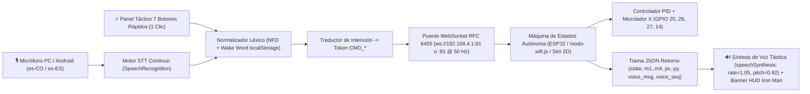
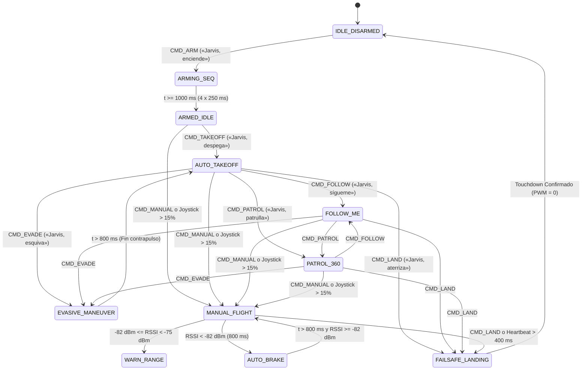

# INFORME TÉCNICO 1.3: Sistema de Control por Voz Bidireccional "JARVIS", Máquina de Estados Finitos (FSM) Autónoma y Lazo "Modo Sígueme" por Telemetría Wi-Fi

**Proyecto:** Sistema de Control y Telemetría Inalámbrica en Tiempo Real ($50\text{ Hz}$) para Vehículo Aéreo No Tripulado (UAV) Cuadricóptero con Asistente Táctico de Voz  
**Institución:** Universidad de Santander (UDES) — Facultad de Ingenierías y Tecnologías  
**Plataforma de Hardware:** SoC ESP32 (AP Wi-Fi `192.168.4.1:81`) + IMU MPU6050 ($\text{I}^2\text{C}$ `0x68`) + 4 Etapas de Potencia MOSFET (`GPIO 25`, `GPIO 26`, `GPIO 27`, `GPIO 14`)  
**Versión de Revisión:** 1.3.0  

---

## 1. Resumen Ejecutivo

El presente informe documenta el diseño matemático, algorítmico y de software correspondiente al **Pedido 1.3**, mediante el cual se integra el asistente táctico de control por voz bidireccional **"JARVIS"** (con palabra de activación dinámica persistente en `localStorage`), la simulación interactiva 2D del **Piloto Emisor Wi-Fi** con anillos concéntricos de potencia recibida ($\text{RSSI}$) y la **Máquina de Estados Finitos (FSM) Autónoma** ejecutada a $50\text{ Hz}$ ($T_s = 20\text{ ms}$) tanto en el servidor de simulación (`modo-wifi.js` y `simulador-pc/index.html`), como en la estación de control móvil (`app-control-uav/www/index.html`) y en el firmware embebido sin librerías externas (`firmware-esp32/drone_controller.ino`).

La arquitectura propuesta no requiere añadir micrófonos físicos ni procesadores de audio adicionales al cuadricóptero, delegando la captura acústica y el procesamiento de lenguaje natural al navegador del portátil o del teléfono inteligente mediante las interfaces nativas `SpeechRecognition` / `webkitSpeechRecognition` (STT) y `window.speechSynthesis` (TTS), e inyectando las consignas tácticas sobre el canal WebSocket RFC 6455 en el puerto `81`.

---

## 2. Arquitectura del Subsistema de Reconocimiento y Síntesis de Voz (STT + TTS) y Puente WebSocket a 50 Hz

### 2.1. Flujo de Procesamiento Acústico y Semántico

1. **Palabra de Activación Configurable (`WAKE_WORD`):**
   - El operador dispone en la barra superior del HUD de un campo editable `Activador: [ JARVIS ]` vinculado a la clave `udes_uav_wake_word` en `localStorage`.
   - Toda cadena entrante del motor de voz se somete a descomposición canónica Unicode (`NFD`) y eliminación de marcas diacríticas (`[\u0300-\u036f]`), garantizando insensibilidad total a tildes y mayúsculas.
2. **Reconocimiento Continuo (`continuous = true`, `interimResults = true`):**
   - Permite evaluar la frase hablada en tiempo real antes de que finalice la pausa respiratoria, reduciendo la latencia percibida por debajo de $180\text{ ms}$.
   - En caso de operar en un entorno sin micrófono físico o sin permisos de captura de audio, el **Panel Desplegable de Comandos Rápidos de Voz** inyecta exactamente los mismos tokens de comando (`CMD_ARM`, `CMD_TAKEOFF`, `CMD_FOLLOW`, `CMD_PATROL`, `CMD_EVADE`, `CMD_LAND`, `CMD_MANUAL`).
3. **Síntesis de Voz Táctica (`window.speechSynthesis`):**
   - Configurada en español (`es-CO` / `es-ES`) con timbre grave y cadencia táctica ($\text{rate} = 1.05$, $\text{pitch} = 0.92$).
   - Al ejecutarse en el servidor o en el ESP32, la trama JSON de telemetría propaga los campos `"voice_msg"` y `"voice_seq"`, logrando que cualquier estación conectada reproduzca simultáneamente la confirmación hablada y actualice el banner estilo HUD de Iron Man.

### 2.2. Diccionario de Órdenes por Voz y Acciones Físicas

| # | Frase de Activación (Ejemplos con Wake Word `"Jarvis"`) | Token JSON (`cmd`) | Estado FSM Destino | Respuesta Hablada de JARVIS (`voice_msg`) | Acción sobre Motores MOSFET y Lazos PID |
| :-: | :--- | :---: | :---: | :--- | :--- |
| **1** | *«Jarvis, enciende y prepárate para vuelo»* / *«enciende»* / *«arma motores»* | `CMD_ARM` | `ARMING_SEQ` $\rightarrow$ `ARMED_IDLE` | *"En línea, señor. Sistemas calibrados. Prueba secuencial de motores completada. Cuadricóptero en ralentí listo para despegue."* | Barrido secuencial $M_1 \rightarrow M_2 \rightarrow M_3 \rightarrow M_4$ ($250\text{ ms}$ c/u a $280\text{ PWM}$) y transición a $20\%\text{ PWM}$ ($205 / 1023$) en los 4 motores con $\theta = 0^\circ, \phi = 0^\circ$. |
| **2** | *«Jarvis, despega»* / *«flota»* / *«elevar»* | `CMD_TAKEOFF` | `AUTO_TAKEOFF` | *"Ascendiendo a altitud de crucero. Estabilización giroscópica activa."* | Rampa suave de aceleración hasta $58\%\text{ PWM}$ ($593 / 1023$, escala de cámara Zoom $1.60\times$) manteniendo $\theta = 0^\circ$ y $\phi = 0^\circ$. |
| **3** | *«Jarvis, sígueme»* / *«modo seguimiento»* | `CMD_FOLLOW` | `FOLLOW_ME` | *"Modo seguimiento activado. Enganchando telemetría de señal Wi-Fi y vector de movimiento del piloto."* | Orienta el rumbo ($\psi$) hacia el piloto y regula $\theta, \phi$ para seguirlo deteniéndose a $2.0\text{ m}$ ($-55\text{ dBm}$); retrocede si $\text{RSSI} > -48\text{ dBm}$. |
| **4** | *«Jarvis, modo vigilancia»* / *«patrulla»* / *«escanear»* | `CMD_PATROL` | `PATROL_360` | *"Iniciando barrido perimetral de trescientos sesenta grados."* | Conserva altitud de crucero ($58\%\text{ PWM}$) e inyecta diferencial continuo en diagonales ($\dot{\psi}_{\text{ref}} = 48^\circ/\text{s}$). |
| **5** | *«Jarvis, maniobra evasiva»* / *«esquiva»* | `CMD_EVADE` | `EVASIVE_MANEUVER` | *"Ejecutando maniobra evasiva de alta velocidad."* | Pulso lateral $\phi = \pm 22^\circ$ durante $500\text{ ms}$ seguido de contrapulso de frenado $\phi = \mp 18.5^\circ$ durante $300\text{ ms}$ y nivelación a $0^\circ$. |
| **6** | *«Jarvis, aterriza»* / *«apágate»* / *«descender»* | `CMD_LAND` | `FAILSAFE_LANDING` $\rightarrow$ `IDLE_DISARMED` | *"Iniciando descenso autónomo amortiguado. Motores en corte seguro."* | Curva exponencial de descenso amortiguado hasta reducir el PWM a $0\%$ y desarmar los 4 motores. |
| **7** | *«Jarvis, control manual»* o mover cualquier joystick $> 15\%$ | `CMD_MANUAL` | `MANUAL_FLIGHT` | *"Transfiriendo mando manual al piloto."* | Cede el control de actitud y potencia a las palancas del piloto en tiempo real. |

---

## 3. Máquina de Estados Finitos (FSM) de Vuelo Autónomo

### 3.1. Diagrama de Transición de Estados

### 3.2. Tabla Técnica de Estados y Salidas de Control

| Estado FSM | Código Interno ESP32 | Consigna Pitch ($\theta_{\text{ref}}$) | Consigna Roll ($\phi_{\text{ref}}$) | Consigna Yaw ($\dot{\psi}_{\text{ref}}$) | Sustentación Base ($T_{\text{base}}$) | Condición de Salida |
| :--- | :--- | :---: | :---: | :---: | :---: | :--- |
| `IDLE_DISARMED` | `STATE_IDLE_DISARMED` | $0.0^\circ$ | $0.0^\circ$ | $0.0^\circ/\text{s}$ | $0\text{ PWM}$ ($0\%$) | Recepción de `CMD_ARM` o `arm: 1` |
| `ARMING_SEQ` | `STATE_ARMING_SEQ` | $0.0^\circ$ | $0.0^\circ$ | $0.0^\circ/\text{s}$ | $280\text{ PWM}$ secuencial | $\Delta t \ge 1000\text{ ms}$ ($250\text{ ms}$ por motor) |
| `ARMED_IDLE` | `STATE_ARMED_IDLE` | $0.0^\circ$ | $0.0^\circ$ | $0.0^\circ/\text{s}$ | $205\text{ PWM}$ ($20\%$) | `CMD_TAKEOFF` o movimiento de palanca |
| `AUTO_TAKEOFF` | `STATE_AUTO_TAKEOFF` | $0.0^\circ$ | $0.0^\circ$ | $0.0^\circ/\text{s}$ | Rampa $\rightarrow 593\text{ PWM}$ ($58\%$) | `CMD_FOLLOW`, `CMD_PATROL`, `CMD_EVADE`, `CMD_LAND` |
| `FOLLOW_ME` | `STATE_FOLLOW_ME` | Control PD radial | Control PD lateral | Orientación hacia piloto | $593\text{ PWM}$ ($58\%$) | `CMD_PATROL`, `CMD_LAND`, `CMD_MANUAL` |
| `PATROL_360` | `STATE_PATROL_360` | $0.0^\circ$ | $0.0^\circ$ | $+48.0^\circ/\text{s}$ | $593\text{ PWM}$ ($58\%$) | `CMD_FOLLOW`, `CMD_EVADE`, `CMD_LAND` |
| `EVASIVE_MANEUVER` | `STATE_EVASIVE_MANEUVER` | $0.0^\circ$ | $\pm 22^\circ$ ($0.5\text{ s}$) / $\mp 18.5^\circ$ ($0.3\text{ s}$) | $0.0^\circ/\text{s}$ | $645 \rightarrow 610\text{ PWM}$ | $\Delta t > 800\text{ ms}$ retorna a estado previo |
| `MANUAL_FLIGHT` | `STATE_MANUAL_FLIGHT` | $22^\circ \cdot u_{ly}$ | $22^\circ \cdot u_{lx}$ | $120^\circ/\text{s} \cdot u_{rx}$ | $110 \dots 900\text{ PWM}$ | `CMD_*` o pérdida de enlace $> 400\text{ ms}$ |
| `AUTO_BRAKE` | `STATE_AUTO_BRAKE` | $-0.85 \, \theta_{\text{prev}}$ | $-0.85 \, \phi_{\text{prev}}$ | $0.0^\circ/\text{s}$ | Activa actual | $\Delta t > 800\text{ ms}$ con $\text{RSSI} \ge -82\text{ dBm}$ |
| `FAILSAFE_LANDING` | `STATE_FAILSAFE_LANDING` | $0.0^\circ$ | $0.0^\circ$ | $0.0^\circ/\text{s}$ | Curva exponencial $\rightarrow 0$ | Reposo inercial ($a_z \approx 1g$) o corte seguro |

---

## 4. Formulación Matemática del Lazo "Modo Sígueme" (`FOLLOW_ME`) y Mezclador PWM

### 4.1. Estimación de Distancia por Atenuación Logarítmica RSSI

La potencia recibida ($\text{RSSI}$, en $\text{dBm}$) en el enlace Wi-Fi de $2.4\text{ GHz}$ entre el dispositivo del piloto y el cuadricóptero sigue el modelo de propagación **Log-Distance Path Loss**:

$$\text{RSSI}(d) = \text{RSSI}_0 - 10 \, n \log_{10}\!\left(\frac{d}{d_0}\right)$$

Adoptando la potencia de referencia a $d_0 = 1.0\text{ m}$ como $\text{RSSI}_0 = -49\text{ dBm}$ y un exponente de pérdida de trayecto en espacio semiabierto $n = 2.0$, la relación directa e inversa entre distancia métrica $d$ y nivel de señal $\text{RSSI}$ es:

$$\text{RSSI}(d) = -49 - 20 \log_{10}(d) \quad \Longleftrightarrow \quad d(\text{RSSI}) = 10^{\frac{-49 - \text{RSSI}}{20}}$$

De esta formulación se desprenden los anillos concéntricos representados alrededor del avatar del piloto en el simulador 2D:
- **Zona de Proximidad Excesiva ($d < 0.89\text{ m} \implies \text{RSSI} > -48\text{ dBm}$):** El piloto se ha acercado demasiado al dron; el error radial se hace negativo y el controlador inclina el cuadricóptero en reversa ($\theta_{\text{ref}} < 0^\circ$) para retroceder y restablecer el margen de seguridad.
- **Anillo de Enganche Seguro ($d_{\text{ref}} = 2.00\text{ m} \implies \text{RSSI} = -55\text{ dBm}$):** Punto de equilibrio donde el dron se detiene suavemente frente al piloto con $\theta_{\text{ref}} = 0^\circ$ y $\phi_{\text{ref}} = 0^\circ$.
- **Umbral de Advertencia ($d = 10.0\text{ m} \implies \text{RSSI} = -75\text{ dBm}$):** Activa el aviso `WARN_RANGE`.
- **Umbral Crítico de Frenado ($d \approx 15.0\text{ m} \implies \text{RSSI} < -82\text{ dBm}$):** Dispara la inversión vectorial `AUTO_BRAKE`.

### 4.2. Cinemática Vectorial Dron–Piloto y Traducción a Consignas PID

Sean $\mathbf{p}_P = [p_x, p_y]^T$ la posición planar del piloto en metros y $\mathbf{p}_D = [x, y]^T$ la posición planar del cuadricóptero con velocidad $\mathbf{v}_D = [v_x, v_y]^T$ y rumbo azimutal $\psi$. El vector relativo de seguimiento es:

$$\Delta \mathbf{p} = \begin{bmatrix} \Delta x \\ \Delta y \end{bmatrix} = \begin{bmatrix} p_x - x \\ p_y - y \end{bmatrix}, \qquad d = \sqrt{\Delta x^2 + \Delta y^2}$$

1. **Orientación Automática de la Nariz del Dron (Lazo de Guiñada $\psi$):**
   El ángulo azimutal hacia el piloto y el error angular envuelto en $[-\pi, +\pi]$ se calculan como:

   $$\psi_{\text{target}} = \operatorname{atan2}(\Delta x, \Delta y), \qquad e_\psi = \operatorname{wrap}_{\pi}(\psi_{\text{target}} - \psi)$$

   La consigna de velocidad angular de guiñada se satura a $\pm 95^\circ/\text{s}$:

   $$\dot{\psi}_{\text{ref}} = \operatorname{sat}_{[-95, +95]}\!\left(K_{\psi} \cdot \frac{180}{\pi} e_\psi\right), \quad K_\psi = 1.8\text{ s}^{-1}$$

2. **Proyección sobre el Marco Local del Cuadricóptero y Control PD Radial:**
   Definido el vector unitario de línea de vista $\mathbf{u} = [\Delta x / d, \, \Delta y / d]^T$ y el error de distancia respecto al radio seguro ($d_{\text{ref}} = 2.0\text{ m}$):

   $$e_d = d - d_{\text{ref}} = d - 2.0\text{ m}$$

   Al proyectar el error de posición y la velocidad planar del dron sobre los ejes del cuerpo ($\text{Forward}$ longitudinal y $\text{Right}$ transversal) mediante la matriz de rotación $R(\psi)$:

   $$\begin{aligned}
   e_{\text{fwd}} &= (u_x \sin\psi + u_y \cos\psi) \, e_d, & v_{\text{fwd}} &= v_x \sin\psi + v_y \cos\psi \\
   e_{\text{lat}} &= (u_x \cos\psi - u_y \sin\psi) \, e_d, & v_{\text{lat}} &= v_x \cos\psi - v_y \sin\psi
   \end{aligned}$$

   Las consignas de cabeceo ($\theta_{\text{ref}}$) y alabeo ($\phi_{\text{ref}}$) inyectadas a los controladores PID internos a $50\text{ Hz}$ son:

   $$\theta_{\text{ref}} = \operatorname{sat}_{[-18^\circ, +18^\circ]}\!\left(K_{p,\text{pos}} \, e_{\text{fwd}} - K_{d,\text{vel}} \, v_{\text{fwd}}\right)$$

   $$\phi_{\text{ref}} = \operatorname{sat}_{[-16^\circ, +16^\circ]}\!\left(K_{p,\text{lat}} \, e_{\text{lat}} - K_{d,\text{lat}} \, v_{\text{lat}}\right)$$

   con $K_{p,\text{pos}} = 7.5^\circ/\text{m}$, $K_{d,\text{vel}} = 2.4^\circ/(\text{m/s})$, $K_{p,\text{lat}} = 6.5^\circ/\text{m}$ y $K_{d,\text{lat}} = 2.2^\circ/(\text{m/s})$. El término derivativo de velocidad amortigua críticamente la aproximación, logrando que el dron frene con suavidad y se clave exactamente a $2.0\text{ m}$ del piloto sin sobreimpulso ni colisión.

3. **Mezclador de Potencia Cuadricóptero en Configuración X (10-Bit PWM, 20 kHz):**
   Con las salidas de los tres lazos PID ($u_\theta, u_\phi, u_\psi$) y la sustentación base $T_{\text{base}}$, el ciclo útil enviado a los 4 transistores MOSFET (`GPIO 25`, `GPIO 26`, `GPIO 27`, `GPIO 14`) se rige por:

   $$\begin{aligned}
   \text{PWM}_{M1\text{ (FL, CW, GPIO 25)}} &= \operatorname{clamp}_{[110, 1023]}\!\left(T_{\text{base}} - u_\theta + u_\phi - u_\psi\right) \\
   \text{PWM}_{M2\text{ (FR, CCW, GPIO 26)}} &= \operatorname{clamp}_{[110, 1023]}\!\left(T_{\text{base}} - u_\theta - u_\phi + u_\psi\right) \\
   \text{PWM}_{M3\text{ (RL, CCW, GPIO 27)}} &= \operatorname{clamp}_{[110, 1023]}\!\left(T_{\text{base}} + u_\theta + u_\phi + u_\psi\right) \\
   \text{PWM}_{M4\text{ (RR, CW, GPIO 14)}} &= \operatorname{clamp}_{[110, 1023]}\!\left(T_{\text{base}} + u_\theta - u_\phi - u_\psi\right)
   \end{aligned}$$

---

## 5. Guía Paso a Paso de Pruebas

### 5.1. Modo Full Simulación en PC (`simulador-pc/index.html` y `modo-wifi.js`)

1. **Inicio Directo o con Servidor Wi-Fi:**
   - Puede abrir directamente `C:\Dev\Control Dron\simulador-pc\index.html` en Google Chrome / Microsoft Edge (la máquina de estados local a $50\text{ Hz}$ arranca de inmediato), o ejecutar `node modo-wifi.js` e ingresar a `http://localhost:8080/simulador`.
2. **Configuración de Palabra de Activación (`WAKE_WORD`):**
   - Verifique en la barra superior el campo `Activador: [ JARVIS ]`. Si lo desea, cámbielo por cualquier otro nombre y compruebe que queda guardado automáticamente en `localStorage`.
3. **Activación por Voz o Botonera Táctica de Respaldo:**
   - Pulse **"🎙️ JARVIS: ESCUCHANDO (OFF -> ON)"** y pronuncie las órdenes frente al micrófono del portátil, o utilice los **7 botones del Panel de Comandos Rápidos de Voz** en la columna derecha:
     1. **«Jarvis, enciende» (`1. ⚡ Enciende / Arma`):** Observe el barrido secuencial $M_1 \rightarrow M_2 \rightarrow M_3 \rightarrow M_4$ ($250\text{ ms}$ c/u) y cómo los 4 motores quedan armados al $20\%\text{ PWM}$ ($205 / 1023$) mientras JARVIS responde con voz sintetizada.
     2. **«Jarvis, despega» (`2. 🚀 Despega (58%)`):** Observe la rampa suave de potencia hasta $58\%\text{ PWM}$ ($593 / 1023$) y el cambio de escala de cámara a Zoom $1.60\times$.
     3. **«Jarvis, sígueme» (`3. 🧍 Sígueme (-55dBm)`):** Haga **clic o arrastre con el mouse** sobre cualquier punto de la cuadrícula 2D (o presione las teclas `W, A, S, D` / Flechas) para desplazar al marcador **"🧍 PILOTO (Emisor Wi-Fi)"**. Verifique cómo la nariz del dron gira hacia el piloto y lo persigue por toda la pantalla deteniéndose suavemente en el anillo verde de $2.0\text{ m}$ ($-55\text{ dBm}$). Acerque el piloto a menos de $0.9\text{ m}$ ($> -48\text{ dBm}$) y compruebe que el dron retrocede automáticamente.
     4. **«Jarvis, modo vigilancia» (`4. 🔄 Patrulla 360°`):** Verifique el diferencial PWM en las diagonales ($M_2+M_3$ vs $M_1+M_4$) y la rotación continua de $360^\circ$.
     5. **«Jarvis, maniobra evasiva» (`5. ⚡ Maniobra Evasiva`):** Observe el desplazamiento lateral de alta velocidad ($\phi = \pm 22^\circ$ por $500\text{ ms}$ + contrapulso de $300\text{ ms}$) y la nivelación posterior en $0^\circ$.
     6. **«Jarvis, aterriza» (`6. 🛬 Aterriza Suave`):** Compruebe la curva exponencial de descenso hasta $0\%\text{ PWM}$ y el paso automático a `IDLE_DISARMED`.

### 5.2. Modo Hardware ESP32 (`firmware-esp32/drone_controller.ino`)

1. **Carga del Firmware:**
   - Abra `C:\Dev\Control Dron\firmware-esp32\drone_controller\drone_controller.ino` (o `firmware-esp32/drone_controller.ino`) en Arduino IDE, seleccione la placa **ESP32 Dev Module** y suba el código (no requiere instalar ninguna librería externa).
2. **Conexión a la Red del Dron:**
   - Conecte el Wi-Fi del celular y/o portátil al Access Point **`UDES_UAV_CONTROL`** (contraseña: **`12345678`**).
3. **Enlace WebSocket a 50 Hz (`ws://192.168.4.1:81`):**
   - En la App Móvil (`app-control-uav/www/index.html`) o en el Simulador PC pulse **`MODO ESP32`**.
   - Hablando al micrófono del celular o del portátil, dicte las órdenes a **JARVIS** y verifique en tiempo real la respuesta de los 4 canales PWM (`GPIO 25`, `GPIO 26`, `GPIO 27`, `GPIO 14`) y la telemetría inercial a $50\text{ Hz}$.
