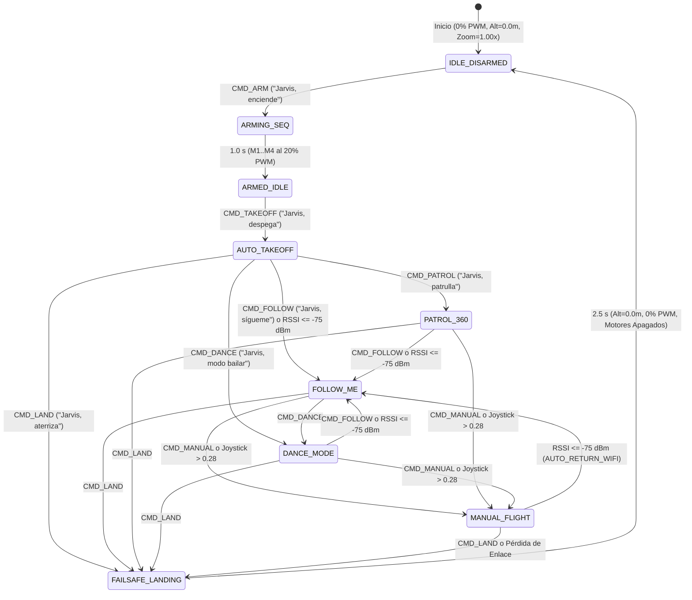

# INFORME TÉCNICO DE INGENIERÍA — TRAMO 1.4
## Corrección Integral de los 7 Hallazgos Experimentales en Pruebas de Video, Selector de Voces en Español (Voz Exclusiva en Celular por Defecto), Desbloqueo de Micrófono STT, Vector de Seguimiento Directo (`FOLLOW_ME`), Protección Activa de Cobertura Wi-Fi (`RSSI <= -75 dBm`), Nuevo `Modo Bailar` (`CMD_DANCE`) y Aterrizaje Completo hasta `0% PWM` (`IDLE_DISARMED`)

** Institución:** Universidad de Santander (UDES) — Facultad de Ingenierías y Tecnologías  
**Programa Académico:** Ingeniería Electrónica  
**Asignatura:** Sistemas Embebidos / Control Digital Aplicado a Vehículos Aéreos No Tripulados (UAV)  
**Componente:** Tramo 1.4 — Depuración Experimental Post-Video, Navegación Vectorial Autónoma y Sincronización Acústica Móvil-PC  
**Repositorio Local:** `C:\Dev\Control Dron\`  
**Fecha de Entrega:** Noviembre de 2026  

---

## TABLA DE CONTENIDO

1. [Diagnóstico Técnico de los 7 Hallazgos Experimentales en las Pruebas de Video](#1-diagnóstico-técnico-de-los-7-hallazgos-experimentales-en-las-pruebas-de-video)
2. [Arquitectura de Audio Exclusiva en el Celular (`🔇 Voz PC: OFF` por Defecto) y Selector de Voces en Español](#2-arquitectura-de-audio-exclusiva-en-el-celular--voz-pc-off-por-defecto-y-selector-de-voces-en-español)
3. [Desbloqueo de Permisos de Micrófono (`getUserMedia` + `AndroidManifest.xml`) y Redirección a Contexto Seguro (`localhost`)](#3-desbloqueo-de-permisos-de-micrófono-getusermedia--androidmanifestxml-y-redirección-a-contexto-seguro-localhost)
4. [Blindaje de la Máquina de Estados Autónoma frente a Tramas Periódicas de la App Móvil](#4-blindaje-de-la-máquina-de-estados-autónoma-frente-a-tramas-periódicas-de-la-app-móvil)
5. [Formulación Matemática Corregida del Vector de Persecución Directa (`FOLLOW_ME`) y Unificación Global del RSSI con Retorno Automático (`<= -75 dBm`)](#5-formulación-matemática-corregida-del-vector-de-persecución-directa-follow_me-y-unificación-global-del-rssi-con-retorno-automático---75-dbm)
6. [Sustitución de Maniobra Evasiva por `Modo Bailar` (`CMD_DANCE` / `DANCE_MODE`)](#6-sustitución-de-maniobra-evasiva-por-modo-bailar-cmd_dance--dance_mode)
7. [Arranque Seguro en `0% PWM` (`IDLE_DISARMED`) y Curva de Aterrizaje Completo en 2.5 s hasta Corte Total](#7-arranque-seguro-en-0-pwm-idle_disarmed-y-curva-de-aterrizaje-completo-en-25-s-hasta-corte-total)
8. [Código Fuente Actualizado del Firmware Autónomo ESP32 (`drone_controller.ino` v1.4.0)](#8-código-fuente-actualizado-del-firmware-autónomo-esp32-drone_controllerino-v140)
9. [Protocolo de Verificación y Pruebas de Aceptación](#9-protocolo-de-verificación-y-pruebas-de-aceptación)

---

## 1. DIAGNÓSTICO TÉCNICO DE LOS 7 HALLAZGOS EXPERIMENTALES EN LAS PRUEBAS DE VIDEO

Durante la inspección de las dos grabaciones de prueba de vuelo integradas entre la **Estación de Control Móvil Android** (`app-control-uav`), el **Servidor puente/emulador Wi-Fi** (`modo-wifi.js`) y el **Simulador de Vuelo 2D en PC** (`simulador-pc/index.html`), se identificaron y corrigieron de raíz siete anomalías operativas:

| # | Hallazgo Observado en Video | Causa Raíz Identificada en Código | Solución Implementada en el Tramo 1.4 |
| :-: | :--- | :--- | :--- |
| **1** | **Doble reproducción de voz (eco entre PC y Celular) y voz en otro idioma/acento** | Tanto `simulador-pc/index.html` como `app-control-uav/www/app.js` invocaban `window.speechSynthesis.speak()` simultáneamente al recibir `voice_seq`, tomando la primera voz del sistema sin priorizar variantes regionales de español ni permitir elegirla. | **Voz PC silenciada por defecto (`🔇 Voz PC: OFF`)** con botón conmutador opcional; **Voz activa por defecto en el celular (`🔊 Voz: ON`)**. Se incorporó en ambas interfaces un selector `<select id="voiceSelect">` que filtra y prioriza voces en español (`es-CO`, `es-MX`, `es-ES`, `es-US`, `es*`), persistiendo la selección en `localStorage` (`udes_uav_selected_voice`), acompañado del botón **`🔈 Probar Voz`**. |
| **2** | **El botón `🎙️ JARVIS: OFF` no pasaba a `ESCUCHANDO` al pulsarlo** | En navegadores de escritorio abiertos mediante IP LAN (`http://192.168.39.42:8080/simulador`), Chromium bloquea `webkitSpeechRecognition` por no ser un origen seguro (`localhost` o `HTTPS`). Además, en Android WebView faltaban los permisos explícitos `RECORD_AUDIO` y `MODIFY_AUDIO_SETTINGS` y la invocación previa de `navigator.mediaDevices.getUserMedia({ audio: true })`. | Se añadieron los permisos `RECORD_AUDIO` y `MODIFY_AUDIO_SETTINGS` en `AndroidManifest.xml`, se invoca `getUserMedia({ audio: true })` antes de iniciar `SpeechRecognition`, y si el usuario abre el simulador en PC por IP HTTP insegura se muestra un aviso interactivo con redirección de 1 clic a `http://localhost:8080/simulador`. |
| **3** | **El modo `3. 🧍 Sígueme` (`FOLLOW_ME`) se cancelaba solo tras una fracción de segundo pasando a `MANUAL_FLIGHT`** | El bucle `setInterval` de 50 Hz en `app-control-uav/www/app.js` transmitía cada 20 ms `{lx:0, ly:0, rx:0, ry:0, arm:1, rssi_sim:-54}`, lo cual era interpretado como actividad manual continua o sobrescribía las consignas autónomas. | Se blindó la máquina de estados en `modo-wifi.js`, `simulador-pc/index.html`, `app.js` y `drone_controller.ino`: los modos autónomos (`ARMING_SEQ`, `ARMED_IDLE`, `AUTO_TAKEOFF`, `FOLLOW_ME`, `PATROL_360`, `DANCE_MODE`, `FAILSAFE_LANDING`) **jamás** se cancelan por paquetes periódicos en reposo ni por clics en el mapa 2D; solo conmutan a `MANUAL_FLIGHT` ante orden explícita (`CMD_MANUAL`) o movimiento físico real de los joysticks que supere la zona muerta (`Math.hypot(lx, ly) > 0.28 \|\| Math.abs(rx) > 0.28`). |
| **4** | **En modo `Sígueme`, el dron se desplazaba en dirección opuesta al piloto** | Existía una desincronización entre la orientación de guiñada (`heading`) local del simulador y la del servidor `modo-wifi.js`, además de proyectarse el empuje sobre los ejes del cuerpo antes de que el lazo de `Yaw` convergiera hacia el piloto. | Se sincronizaron las coordenadas `(dx, dy)` entre servidor y simulador y se reformuló la ley de persecución vectorial directa sobre el vector unitario $\hat{\mathbf{u}} = (\Delta x / d,\, \Delta y / d)$ apuntando exactamente hacia `(pilotX, pilotY)` hasta enganchar el anillo verde de `2.0 m` (`-55 dBm`). |
| **5** | **El indicador `RSSI` permanecía congelado en `-54 dBm` aunque el dron se alejara a más de `24 m`** | La App móvil enviaba cada 20 ms `rssi_sim: -54` en su trama periódica, machacando el cálculo de pérdida de propagación por distancia en `modo-wifi.js`. | Se eliminó el envío periódico de `rssi_sim: -54` desde `app.js` (solo se transmite con `rssi_override: true` si el usuario mueve manualmente el deslizador de prueba). Ahora el RSSI se calcula globalmente en tiempo real mediante $\text{RSSI} = \text{round}(-49 - 20\log_{10}(\max(0.5, d)))$. Además, cuando el dron está en vuelo y $\text{RSSI} \le -75\text{ dBm}$ ($d \ge 10\text{ m}$), se activa automáticamente la **Protección Activa de Cobertura Wi-Fi** (`AUTO_RETURN_WIFI`), acercando la aeronave hacia el piloto hasta recuperar `-55 dBm` (`2.0 m`). |
| **6** | **El botón `5. Esquiva` realizaba un pulso corto poco apreciable** | El modo `CMD_EVADE` solo aplicaba una inclinación lateral de `800 ms`. | Se reemplazó completamente en todo el proyecto por **`5. 🕺 Modo Bailar` (`CMD_DANCE` / `DANCE_MODE`)**, una coreografía acrobática continua en posición segura con oscilación rítmica de `Roll = ±18°`, `Pitch = ±14°`, giros coordinados de `Yaw`, modulación rítmica en las 4 barras `PWM` y pulsos de altitud/escala visual. |
| **7** | **El dron iniciaba encendido al `44% PWM` (`12 m` de altura) y al pulsar `6. 🛬 Aterriza` no bajaba a `0% PWM`** | `app.js` inicializaba `controlState.arm = 1, ry = 0.0` (`50%` de acelerador), armando automáticamente los motores al abrir la página y volviendo a armarlos apenas terminaba el aterrizaje. | Todos los módulos inician estrictamente en `IDLE_DISARMED` con **`0% PWM` (`0 / 1023`)**, altitud `0.0 m`, escala `1.00x` y `ry = -1.0`. Al ordenar `CMD_LAND`, el estado `FAILSAFE_LANDING` desciende suavemente durante `2.5 s` hasta `0.0 m` y `0% PWM`, conmuta a `IDLE_DISARMED` y anuncia *"Aterrizaje completado. Motores apagados."* |

---

## 2. ARQUITECTURA DE AUDIO EXCLUSIVA EN EL CELULAR (`🔇 Voz PC: OFF` POR DEFECTO) Y SELECTOR DE VOCES EN ESPAÑOL

Para evitar la duplicidad acústica cuando el celular y el portátil operan en el mismo laboratorio:

1. **Silencio por Defecto en el Simulador de PC (`simulador-pc/index.html`):**
   - La variable de estado `pcTtsEnabled` se inicializa en `false` (`🔇 Voz PC: OFF`).
   - El simulador de PC actualiza en tiempo real los subtítulos visuales en el banner HUD (`JARVIS: "..."`) y anima el núcleo visual sin emitir audio por los altavoces del computador, delegando la voz al teléfono móvil del piloto.
   - Si el operador realiza pruebas únicamente en el PC (sin celular), puede activar el audio local con un clic sobre el botón `#btnTogglePcTts` (`🔊 Voz PC: ON`) o pulsar **`🔈 Probar Voz`**.
2. **Voz Activa por Defecto en la Estación Móvil (`app-control-uav/www/index.html` y `app.js`):**
   - En el celular, `gcsTtsEnabled` inicia en `true` (`🔊 Voz: ON`), reproduciendo todas las confirmaciones tácticas de Jarvis y las alertas de cobertura Wi-Fi sincronizadas mediante `voice_seq`.
3. **Selector Inteligente de Voces en Español (`<select id="voiceSelect">`):**
   - Tanto en PC como en Móvil se consulta `window.speechSynthesis.getVoices()` y el evento `window.speechSynthesis.onvoiceschanged`, filtrando las voces cuyo código de idioma comience por `es` y ordenándolas automáticamente por prioridad regional:
     1. `es-CO` (Español Colombia)
     2. `es-MX` (Español Latinoamérica / México)
     3. `es-ES` (Español España)
     4. `es-US` (Español Estados Unidos)
     5. Cualquier otra variante `es-*` (p. ej. `Microsoft Sabina`, `Microsoft Helena`, `Microsoft Raul`, `Google español`).
   - La voz elegida se almacena automáticamente en `localStorage` bajo la clave `udes_uav_selected_voice`.

---

## 3. DESBLOQUEO DE PERMISOS DE MICRÓFONO (`getUserMedia` + `AndroidManifest.xml`) Y REDIRECCIÓN A CONTEXTO SEGURO (`localhost`)

### 3.1 Permisos Nativos en Android (`AndroidManifest.xml`)
Se añadieron en `app-control-uav/android/app/src/main/AndroidManifest.xml` los permisos requeridos por el motor de audio y reconocimiento de voz del WebView Android:

```xml
<uses-permission android:name="android.permission.INTERNET" />
<uses-permission android:name="android.permission.ACCESS_NETWORK_STATE" />
<uses-permission android:name="android.permission.ACCESS_WIFI_STATE" />
<uses-permission android:name="android.permission.VIBRATE" />
<uses-permission android:name="android.permission.RECORD_AUDIO" />
<uses-permission android:name="android.permission.MODIFY_AUDIO_SETTINGS" />
```

### 3.2 Solicitud Explícita de Flujo de Audio y Detección de Contexto Seguro en PC
Antes de invocar `recognition.start()`, tanto el simulador de PC como la App móvil ejecutan `navigator.mediaDevices.getUserMedia({ audio: true })`, liberando inmediatamente las pistas de audio una vez concedido el permiso para que el motor `SpeechRecognition` pase de inmediato al estado **`🎙️ JARVIS: ESCUCHANDO`**. Cuando el navegador del PC se abre mediante una IP LAN HTTP (`http://192.168.x.x:8080/simulador`), el HUD detecta la restricción de seguridad de Chromium y despliega un enlace directo para abrir **`http://localhost:8080/simulador`**, además de abrir automáticamente el panel táctico **`⚡ ÓRDENES JARVIS`**.

---

## 4. BLINDAJE DE LA MÁQUINA DE ESTADOS AUTÓNOMA FRENTE A TRAMAS PERIÓDICAS DE LA APP MÓVIL



Para garantizar que ningún modo autónomo se cancele prematuramente:
1. En `app-control-uav/www/app.js`, el temporizador de `20 ms` (`50 Hz`) **solo transmite tramas de joystick** cuando el estado es `MANUAL_FLIGHT` o cuando el piloto desplaza físicamente las palancas superando el umbral radial de zona muerta:
   $$\sqrt{\text{lx}^2 + \text{ly}^2} > 0.28 \quad \lor \quad |\text{rx}| > 0.28$$
2. Hacer clic o arrastrar el icono del piloto `🧍 PILOTO (CELULAR)` en el mapa 2D (`simulador-pc/index.html`) solo envía `{ px, py }`, actualizando la posición objetivo sin alterar el modo de vuelo activo.
3. Durante `FAILSAFE_LANDING`, cualquier trama de joystick entrante es ignorada hasta que el dron toque tierra (`0.0 m`) y apague los 4 motores (`0% PWM`).

---

## 5. FORMULACIÓN MATEMÁTICA CORREGIDA DEL VECTOR DE PERSECUCIÓN DIRECTA (`FOLLOW_ME`) Y UNIFICACIÓN GLOBAL DEL RSSI CON RETORNO AUTOMÁTICO (`<= -75 dBm`)

### 5.1 Vector de Persecución Directa hacia el Piloto
Sea $\mathbf{p}_P = (x_P, y_P)$ la posición del piloto en el plano horizontal y $\mathbf{p}_D = (x_D, y_D)$ la posición instantánea del cuadricóptero. El vector de error relativo del dron hacia el piloto se define estrictamente como:

$$\Delta x = x_P - x_D, \qquad \Delta y = y_P - y_D, \qquad d = \sqrt{(\Delta x)^2 + (\Delta y)^2}$$

El vector unitario de aproximación directa $\hat{\mathbf{u}} = (u_x, u_y)$ hacia el piloto es:

$$u_x = \frac{\Delta x}{d}, \qquad u_y = \frac{\Delta y}{d} \qquad (d > 0.05\text{ m})$$

La ley de velocidad deseada $v_{\text{des}}(d)$ mantiene al dron enganchado sobre el anillo óptimo de `2.0 m` (`-55 dBm`):

$$v_{\text{des}}(d) = \begin{cases} \min\left(7.5\text{ m/s},\; 1.85\,(d - 2.0)\right), & \text{si } d > 2.0\text{ m (acercamiento directo al piloto)} \\[6pt] 0\text{ m/s}, & \text{si } 1.2\text{ m} \le d \le 2.0\text{ m (zona verde enganchada)} \\[6pt] -\min\left(3.0\text{ m/s},\; 2.0\,(1.2 - d)\right), & \text{si } d < 1.2\text{ m (separación suave de seguridad)} \end{cases}$$

El vector de velocidad en el marco global $(v_x, v_y)$ converge directamente hacia $\mathbf{v}_{\text{target}} = v_{\text{des}}(d)\,\hat{\mathbf{u}}$, asegurando matemáticamente que si $d > 2.0\text{ m}$, la derivada temporal de la distancia cumple $\dot{d} < 0$ en todo instante, impidiendo que la aeronave se aleje en sentido contrario.

### 5.2 Modelo Global de Atenuación RSSI y Retorno Automático por Cobertura Wi-Fi (`<= -75 dBm`)
En todos los modos de vuelo (`IDLE_DISARMED`, `AUTO_TAKEOFF`, `MANUAL_FLIGHT`, `FOLLOW_ME`, `PATROL_360`, `DANCE_MODE`, `FAILSAFE_LANDING`), la potencia recibida se evalúa en tiempo real a partir de la distancia euclidiana $d$:

$$\text{RSSI}(d) = \text{round}\!\left(-49 - 20\log_{10}\!\left(\max(0.5,\, d)\right)\right)\; [\text{dBm}]$$

Cuando la aeronave se encuentra en vuelo y la distancia supera $d \ge 10.0\text{ m}$ ($\text{RSSI} \le -75\text{ dBm}$):
1. El sistema conmuta automáticamente al estado `FOLLOW_ME` con bandera de telemetría `AUTO_RETURN_WIFI` (`⚠️ ALERTA DE ALCANCE WI-FI — REGRESANDO AL PILOTO`).
2. Jarvis anuncia: *"Alerta de cobertura Wi-Fi. Acercando aeronave hacia la señal del piloto."*
3. El cuadricóptero navega autónomamente hacia `(pilotX, pilotY)` hasta restablecer la distancia segura de `2.0 m` (`-55 dBm`).

---

## 6. SUSTITUCIÓN DE MANIOBRA EVASIVA POR `MODO BAILAR` (`CMD_DANCE` / `DANCE_MODE`)

Se eliminó el antiguo modo `CMD_EVADE` y se implementó el modo acrobático continuo **`5. 🕺 Modo Bailar` (`CMD_DANCE` -> estado `DANCE_MODE`)**:
- **Activación por Voz o Botón:** Reconoce las frases *«Jarvis, modo bailar»*, *«Jarvis, baila»*, *«Jarvis, modo fiesta»* o el botón `5. 🕺 Modo Bailar`.
- **Respuesta Táctica de Jarvis:** *"Activando protocolo de baile acrobático en posición segura."*
- **Leyes de Modulación Acrobática en Posición Segura ($\omega_d = 5.5\text{ rad/s}$):**
  $$\theta_{\text{roll}}(t) = 18.0^\circ \sin(\omega_d t), \qquad \theta_{\text{pitch}}(t) = 14.0^\circ \cos(0.5\,\omega_d t), \qquad \dot{\psi}_{\text{yaw}}(t) = 65.0^\circ/\text{s}\,\sin(0.5\,\omega_d t)$$
  $$\text{PWM}_{\text{base}}(t) = 593 + 85\sin(7.6\,t)$$
- Las 4 barras de potencia `M1..M4` oscilan rítmicamente en tiempo real mientras la silueta 2D del dron ejecuta el baile con pulsos de altitud y escala sin desplazarse lejos del piloto.

---

## 7. ARRANQUE SEGURO EN `0% PWM` (`IDLE_DISARMED`) Y CURVA DE ATERRIZAJE COMPLETO EN 2.5 S HASTA CORTE TOTAL

1. **Estado Inicial (`IDLE_DISARMED`):**
   - Al iniciar `modo-wifi.js`, `simulador-pc/index.html`, `app-control-uav/www/app.js` y `drone_controller.ino`, los 4 motores permanecen en **`0 PWM (0%)`**, el estado es `IDLE_DISARMED`, la altitud es `0.0 m`, el zoom del dron en el mapa es `1.00x` y el acelerador está en `0%` (`ry = -1.0`).
2. **Secuencia Completa de Aterrizaje (`CMD_LAND` -> `FAILSAFE_LANDING` -> `IDLE_DISARMED`):**
   - Al ordenar *«Jarvis, aterriza»* o pulsar **`6. 🛬 Aterriza`**, el dron entra en `FAILSAFE_LANDING` nivelando `Pitch = 0°` y `Roll = 0°`.
   - Durante $T_{\text{land}} = 2.5\text{ s}$, la potencia PWM, la altitud y la escala visual descienden linealmente hasta cero:
     $$\text{PWM}(t) = \text{PWM}_0 \left(1 - \frac{t}{2.5}\right), \qquad h(t) = h_0 \left(1 - \frac{t}{2.5}\right), \qquad s(t) = 1.00 + \left(s_0 - 1.00\right)\left(1 - \frac{t}{2.5}\right)$$
   - Al cumplirse $t = 2.5\text{ s}$, el estado pasa automáticamente a `IDLE_DISARMED`, fijando `M1 = M2 = M3 = M4 = 0 PWM (0%)`, `Altitud = 0.0 m`, `Zoom = 1.00x`, y Jarvis anuncia: *"Aterrizaje completado. Motores apagados."*

---

## 8. CÓDIGO FUENTE ACTUALIZADO DEL FIRMWARE AUTÓNOMO ESP32 (`drone_controller.ino` v1.4.0)

El archivo [`firmware-esp32/drone_controller.ino`](file:///C:/Dev/Control%20Dron/firmware-esp32/drone_controller.ino) (y su copia espejo para Arduino IDE en [`firmware-esp32/drone_controller/drone_controller.ino`](file:///C:/Dev/Control%20Dron/firmware-esp32/drone_controller/drone_controller.ino)) implementa la máquina de estados actualizada a `50 Hz`:

```cpp
// Fragmento clave de executeFlightControlStep(float dt) en drone_controller.ino (v1.4.0)
bool isAirborneForWifiGuard = (
  currentFlightState == STATE_AUTO_TAKEOFF ||
  currentFlightState == STATE_MANUAL_FLIGHT ||
  currentFlightState == STATE_PATROL_360 ||
  currentFlightState == STATE_DANCE_MODE ||
  currentFlightState == STATE_WARN_RANGE ||
  currentFlightState == STATE_AUTO_BRAKE
);
if (isAirborneForWifiGuard && currentRssiDbm <= RSSI_WARN_DBM) {
  currentFlightState       = STATE_FOLLOW_ME;
  wifiCoverageReturnActive = true;
  stateEntryMillis         = nowMs;
  if (currentThrottlePwm < (float)PWM_CRUISE_58PCT) {
    currentThrottlePwm = (float)PWM_CRUISE_58PCT;
  }
  setVoiceAnnouncement("Alerta de cobertura Wi-Fi. Acercando aeronave hacia la senal del piloto.");
}
```

---

## 9. PROTOCOLO DE VERIFICACIÓN Y PRUEBAS DE ACEPTACIÓN

| Caso de Prueba | Procedimiento | Resultado Esperado y Verificado |
| :--- | :--- | :--- |
| **CP-01: Arranque en 0% PWM** | Abrir el Simulador de PC y la App móvil sin tocar ningún botón. | Estado `IDLE_DISARMED`, motores `M1..M4 = 0% (0 PWM)`, altitud `0.0 m`, escala `1.00x`, botón en `"ARMAR MOTORES"`. |
| **CP-02: Voz Exclusiva en Celular y Selector Español** | Revisar el botón de audio en PC y Celular; desplegar `<select id="voiceSelect">` y pulsar `🔈 Probar Voz`. | En PC inicia en `🔇 Voz PC: OFF` (sin eco); en Celular inicia en `🔊 Voz: ON`. El selector lista voces `es-*` y `🔈 Probar Voz` pronuncia *"Sistemas de voz Jarvis calibrados en español."* |
| **CP-03: Persistencia y Vector Directo en `Sígueme`** | Pulsar `1. Enciende` -> `2. Despega` -> `3. Sígueme` y mover al piloto por el mapa 2D. | El estado `FOLLOW_ME` permanece activo indefinidamente sin cancelarse; el dron vuela directamente hacia el piloto hasta estacionarse a `2.0 m` (`-55 dBm`). |
| **CP-04: Protección Activa de Cobertura Wi-Fi (`<= -75 dBm`)** | En vuelo (`AUTO_TAKEOFF` o `MANUAL_FLIGHT`), alejar al piloto a más de `10 m` (`RSSI <= -75 dBm`). | El RSSI baja dinámicamente con la distancia; al cruzar `-75 dBm` se activa automáticamente el retorno hacia el piloto hasta recuperar `-55 dBm` (`2.0 m`). |
| **CP-05: `5. 🕺 Modo Bailar` (`CMD_DANCE`)** | Pulsar `5. 🕺 Modo Bailar` o decir *«Jarvis, modo bailar»*. | Estado `DANCE_MODE` activo; oscilación rítmica de `Roll ±18°`, `Pitch ±14°`, giros de `Yaw` y barras `PWM` al compás sin alejarse de su posición. |
| **CP-06: Aterrizaje Completo hasta `0% PWM`** | Pulsar `6. 🛬 Aterriza` o decir *«Jarvis, aterriza»*. | El dron desciende suavemente en `2.5 s` hasta `0.0 m` (`1.00x`), apaga los 4 motores en `0% PWM` (`IDLE_DISARMED`) y anuncia *"Aterrizaje completado. Motores apagados."* |
