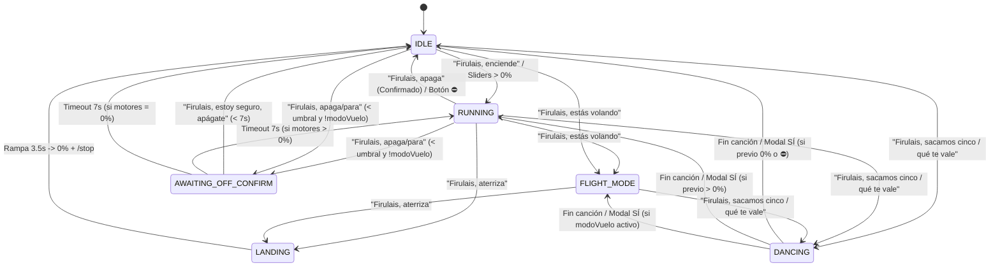

# INFORME TÉCNICO 4.1 — Asistente de Voz "Firulais" 100% Offline, Coreografías PWM y Capas de Seguridad de Vuelo

## 1. Resumen Ejecutivo

Se evolucionó la aplicación Android híbrida (Capacitor + plugin nativo `VoskVoicePlugin.java` + interfaz web autocontenida en `app-control-uav/www/index.html`) para incorporar al asistente de voz **"Firulais"** 100% offline, manteniendo intacto el firmware Wi-Fi del ESP32 en `http://192.168.4.1` (red `UDES_MOTORES_TEST`, endpoints `/status`, `/set?m1=..&m2=..&m3=..&m4=..`, `/stop`, `/seq` y `/ramp`).

### Archivos Modificados o Generados
- `app-control-uav/android/app/src/main/assets/audio/sacamos_cinco.mpeg` (376,366 bytes, copia limpia de `WhatsApp Audio 2026-11-20 at 7.03.11 AM.mpeg`).
- `app-control-uav/android/app/src/main/assets/audio/que_te_vale.mpeg` (544,385 bytes, copia limpia de `WhatsApp Audio 2026-11-20 at 7.03.55 AM.mpeg` — *nota: en `pedido-4.1.md` figuraba con un error tipográfico de segundos como `7.03.35`, siendo `7.03.55` el único segundo archivo presente en `Tramos\4to\Canciones\`*).
- `app-control-uav/android/app/src/main/AndroidManifest.xml` (declaración `<queries>` para descubrir motores `TextToSpeech` en Android 11+ / API 34).
- `app-control-uav/android/app/build.gradle` (`noCompress 'mpeg'` dentro de `aaptOptions` para lectura directa mediante `AssetFileDescriptor`).
- `app-control-uav/android/app/src/main/java/edu/udes/uav/gcs/VoskVoicePlugin.java` (modo español abierto Vosk, TTS masculino offline con prevención de auto-escucha y `MediaPlayer` nativo sincronizado).
- `app-control-uav/www/index.html` (máquina de estados de 6 estados, umbral de helio configurable, calibración de `"Firulais"`, coreografías sincronizadas cada ~90 ms, modal de bloqueo en baile y pruebas rápidas de respaldo).
- `app-control-uav/www/uav-control.apk` (56.88 MB, compilado con `compilar-apk.ps1` tras eliminar el APK previo).

---

## 2. Arquitectura de Voz, TTS y Audio 100% Offline

### 2.1 Inspección del Vocabulario Vosk (`vosk-model-small-es-0.42`) y Decisión de Reconocimiento
Al inspeccionar `app-control-uav/android/app/src/main/assets/vosk-model-es/graph/` se verificó que:
1. El modelo embebido **no incluye `words.txt`** en texto plano; utiliza los grafos FST compilados `Gr.fst` (21,818,215 bytes) y `HCLr.fst` (12,226,498 bytes).
2. Al inspeccionar los símbolos presentes en `Gr.fst`:
   - **Ausentes del diccionario:** `"firulais"`, `"firulay"`, `"firulays"`, `"firulas"`, `"pirulais"`, `"virulais"`, `"ferulais"`, `"firu"`, `"filu"`, `"apagate"`, `"apágate"`, `"mondá"`.
   - **Presentes en el diccionario:** `"firo"`, `"fiero"`, `"lais"`, `"lay"`, `"enciende"`, `"prende"`, `"arranca"`, `"apaga"`, `"para"`, `"detener"`, `"aterriza"`, `"aterrizar"`, `"volando"`, `"seguro"`, `"sacamos"`, `"cinco"`, `"vale"`, `"monda"`, `"estás"`, `"estas"`, `"qué"`, `"que"`.

**Consecuencia de diseño:** Si se hubiera pasado `"firulais"` dentro de una gramática cerrada (`new Recognizer(model, 16000.0f, grammarJson)`), Vosk lo habría descartado sistemáticamente como `[unk]`. Por ello, `VoskVoicePlugin.java` instancia por defecto `new Recognizer(model, SAMPLE_RATE)` en **modo español abierto (`open-spanish`)**, permitiendo obtener la transcripción fonética real (por ejemplo `"firo lais"` o `"fiero lais"`).

### 2.2 Regla Estricta del Activador `"Firulais"` y Calibración
1. Cada frase recibida en `handleVoiceResult()` se normaliza en JavaScript (`minúsculas`, descomposición NFD sin diacríticos, eliminación de signos y compactación de espacios).
2. `extractWakeCommand(normText)` ordena los alias por longitud descendente y **exige que la frase comience exactamente por uno de ellos** (`normText === alias` o `normText.startsWith(alias + " ")`). Si no comienza con el activador, se ignora por completo.
3. Alias incluidos por defecto en `localStorage` (`udes_firulais_aliases_v1`):
   `firulais, firulay, firulays, firu lais, firo lais, filu lais, pirulais, ferulais, virulais, firulas, fiero lais, firo lay, fiero lay, filo lais, filo lay, tiro lais, piro lais, firo las, fiero las, firu lay, firo leis, fiero leis`.
4. Botón **`🧪 Calibrar 'Firulais'`**: inicia escucha si estaba detenida, espera el siguiente resultado final (`isFinal === true`, ventana de 10 s, 1 a 4 palabras), lo agrega al principio de `wakeAliases`, lo persiste en `localStorage` y confirma con TTS.

### 2.3 Síntesis de Voz Masculina (`TextToSpeech`) y Prevención de Auto-Escucha
En `VoskVoicePlugin.java`:
- Se inicializa `TextToSpeech` en el hilo principal (`mainHandler`) al cargar el plugin (`load()` y respaldo en `initModel()`).
- Se evalúan locales en orden: `es-CO`, `es-MX`, `es-US`, `es-ES`, `es`.
- `selectBestSpanishMaleVoice()` recorre `tts.getVoices()`, descarta voces no instaladas (`KEY_FEATURE_NOT_INSTALLED`), da prioridad (+50) a voces **100% offline** (`!voice.isNetworkConnectionRequired()`), bonifica el acento `CO` (+18) / `MX`/`US`/`ES` (+10) y puntúa pistas masculinas (+40) frente a femeninas (-30).
- Aplica timbre grave masculino: `setPitch(0.78f)` y `setSpeechRate(1.02f)`, con `AudioAttributes.USAGE_MEDIA` / `CONTENT_TYPE_SPEECH`.
- **Doble capa anti-eco (sin auto-escucha):**
  1. **Capa Nativa (Java):** `UtteranceProgressListener` (`onStart`, `onDone`, `onError`, `onStop`) actualiza `ttsSpeaking`, pausa el micrófono de Vosk con `speechService.setPause(ttsSpeaking || isSongPlaying)`, aplica una ventana de silencio post-audio `POST_AUDIO_MUTE_MS = 450` ms en `emitVoiceResult()` y protege con un watchdog de 15 s para evitar bloqueos en motores OEM. Emite `ttsStart` y `ttsEnd` hacia JavaScript.
  2. **Capa Web (JS):** Al recibir `ttsStart` marca `isTtsSpeaking = true`; al recibir `ttsEnd` activa `ttsMuteUntilMs = Date.now() + 450` ms y descarta cualquier `voiceResult` durante ese intervalo.

### 2.4 Reproductor Nativo de Canciones (`MediaPlayer`)
- `playSong({ songId })` mapea `"sacamos_cinco"` -> `audio/sacamos_cinco.mpeg` y `"que_te_vale"` -> `audio/que_te_vale.mpeg`.
- Detiene cualquier TTS en curso, carga `AssetFileDescriptor` vía `assets.openFd(...)` (con extracción automática de respaldo a `cacheDir` si el archivo estuviera comprimido), pausa Vosk (`isSongPlaying = true`), inicia la reproducción y al finalizar (`OnCompletionListener`) libera el `MediaPlayer`, reactiva la escucha y emite `songEnded`.
- `getSongProgress()` expone `{ playing, songId, currentPositionMs, durationMs }` para sincronizar la coreografía PWM cada ~90 ms sin deriva temporal.
- `stopSong()` detiene y libera limpiamente el `MediaPlayer` cuando el usuario confirma cancelar el baile mediante el modal.

---

## 3. Máquina de Estados y Capas de Seguridad de Apagado

### Tabla de Estados y Protecciones

| Estado | Badge en HUD | Respuesta ante comandos de voz | Capas de Seguridad Activas |
| :--- | :--- | :--- | :--- |
| `IDLE` | `LISTO` | Acepta todos los comandos con activador `"Firulais"` | Motores en `0%`. |
| `RUNNING` | `EN MARCHA` | Acepta todos los comandos con activador `"Firulais"` | Si `velocidadActual >= umbralDespegueHelio` (55% por defecto), **`apaga`/`para` se bloquea** con TTS *"Estoy volando, te paso el control manual"*. |
| `FLIGHT_MODE` | `✈️ MODO VUELO` | Acepta `aterriza`, `enciende`, bailes; **`apaga`/`para` bloqueado** | Banner `✈️ MODO VUELO ACTIVO (Apagado bloqueado)`. Único apagado por voz: `Firulais, aterriza`. |
| `AWAITING_OFF_CONFIRM` | `⚠️ CONFIRMAR APAGADO` | Espera `Firulais, estoy seguro, apágate` (también acepta `aterriza` / `enciende`) | Cuenta regresiva de **7 s** tras terminar el TTS *"¿Estás seguro?"*; si expira, cancela sin apagar. |
| `LANDING` | `🛬 ATERRIZANDO` | Ignora voz para proteger la rampa | Rampa no bloqueante de ~3.5 s (pasos cada 150 ms) desde PWM actual hasta `0%`, finalizando con `/stop` y `modoVuelo = false`. |
| `DANCING` | `🕺 BAILANDO` | **Todos los comandos de voz ignorados** (incluyendo `apaga`/`para`) | Tocar cualquier slider, botón de potencia, rutina o botón rojo `⛔ APAGAR TODO` abre el modal `🕺 Baile en curso` (*"¿Seguro que quieres deshabilitar el baile?"*). |

### Resumen de las 3 Capas de Protección contra Apagado Accidental
1. **Capa 1 — Umbral de Despegue con Helio (`🎈 10%–95%`, defecto `55%`):** Si el promedio PWM actual de los 4 motores iguala o supera este umbral, `Firulais, apaga` o `Firulais, para` nunca apaga ni pide confirmación; responde **"Estoy volando, te paso el control manual"** y resalta los sliders manuales.
2. **Capa 2 — Bandera Explícita `"Firulais, estás volando"` (`modoVuelo = true`):** Bloquea el apagado directo a cualquier porcentaje PWM. El usuario solo puede bajar por voz diciendo **`Firulais, aterriza`** (descenso controlado de ~3.5 s) o usando los sliders manuales / botón rojo de emergencia.
3. **Capa 3 — Doble Confirmación en Tierra (`AWAITING_OFF_CONFIRM`):** Estando por debajo del umbral y sin `modoVuelo`, decir `Firulais, apaga` dispara el TTS **"¿Estás seguro?"** y un aviso parpadeante de **7 segundos** esperando **`Firulais, estoy seguro, apágate`** antes de enviar `/stop`.

---

## 4. Coreografías PWM Sincronizadas (`DANCE_TICK_MS = 90 ms`)

Parámetros configurables guardados en `localStorage` (`udes_firulais_dance_cfg_v1`):
- **Potencia base efectiva:** `base = Math.max(danceBasePct, promedioPrevio)` (por defecto `danceBasePct = 45%`).
- **Amplitud / intensidad:** `amp = danceAmpPct` (rango `5%–35%`, defecto `20%`).
- **Piso mínimo de seguridad:** `floor = danceMinPct` (rango `5%–50%`, defecto `15%`; todo valor PWM se recorta a `[floor, 100]`).
- **Control HTTP sin solapamiento:** Cada ~90 ms se consulta `getSongProgress()` y solo se envía `/set?m1=..&m2=..&m3=..&m4=..` si no hay una petición anterior en curso (`danceHttpInFlight`).

### 4.1 Coreografía 1: `"Firulais, sacamos cinco"` (`sacamos_cinco.mpeg` — 14.0 s)

| Tramo Temporal | Sección Musical / Coreográfica | Comportamiento PWM en M1, M2, M3, M4 |
| :--- | :--- | :--- |
| `0.0 s – 2.5 s` | Fanfarria de entrada de trompetas | 3 golpes ascendentes simultáneos en los 4 motores: `base + 0.40·amp` (0–0.45s) → pausa → `base + 0.70·amp` (0.75–1.25s) → pausa → `base + 1.00·amp` (1.55–2.30s) → transición a `base`. |
| `2.5 s – 5.5 s` | Compases 1–2 (~136 BPM, paso 220 ms) | Balanceo lateral rápido izquierda `(M1,M3)` vs derecha `(M2,M4)`: lado alto `base + amp·acento`, lado bajo `base - 0.75·amp·acento` (con acento `1.0` cada 440 ms y `0.75` en contratempo). |
| `5.5 s – 8.5 s` | Compases 3–4 | Balanceo frontal `(M1,M2)` vs trasero `(M3,M4)` a `±0.85/0.75·amp` cada 220 ms, interrumpido por pulsos de empuje en golpes de trompeta cada 880 ms (`M1,M2 = base + 0.90·amp`, `M3,M4 = base + 0.75·amp`). |
| `8.5 s – 10.5 s` | Compás 5 | Paso cruzado/diagonal cada 220 ms alternando `(M1,M4)` altos vs `(M2,M3)` bajos (`+0.95·amp` / `-0.80·amp`). |
| `10.5 s – 12.6 s` | Compás 6 | Balanceo lateral veloz de celebración cada 180 ms alternando `(M1,M3)` vs `(M2,M4)` (`+1.00·amp` / `-0.85·amp`). |
| `12.6 s – 14.0 s` | Cierre triunfal | Doble golpe final de los 4 motores (`base + 0.95·amp` y `base + 1.05·amp` con breve respiro en `base - 0.30·amp`) y rampa suave de cierre hacia la potencia previa. |

### 4.2 Coreografía 2: `"Firulais, qué te vale"` (`que_te_vale.mpeg` — 22.0 s)

| Tramo Temporal | Sección Musical / Coreográfica | Comportamiento PWM en M1, M2, M3, M4 |
| :--- | :--- | :--- |
| `0.0 s – 2.6 s` | *"Me vale mondá, me vale mondá"* (parte 1) | Balanceo lateral marcado cada 480 ms: `(M1,M3)` vs `(M2,M4)` entre `base + 0.85·amp` y `base - 0.75·amp`. |
| `2.6 s – 5.2 s` | *"Me vale mondá, me vale mondá"* (parte 2) | Balanceo frontal/trasero marcado cada 480 ms: `(M1,M2)` vs `(M3,M4)` entre `base + 0.85·amp` y `base - 0.75·amp`. |
| `5.2 s – 11.4 s` | *"¡Aaaah, ah, ah, ah, ah!"* — Bajoncitos bruscos (diente de sierra cada 600 ms) | En cada ciclo de 600 ms: **0–200 ms** caída brusca de los 4 motores a `max(floor, base - 1.45·amp)`; **200–380 ms** recuperación rápida a `min(100, base + 0.45·amp)` con ligero cabeceo frontal/trasero alternado (`±0.20·amp`); **380–600 ms** sostén breve en `base + 0.15·amp`. |
| `11.4 s – 15.6 s` | Segundo *"Me vale mondá, me vale mondá"* | Recuperación con balanceo enérgico cada 400 ms: lateral `(M1,M3)` vs `(M2,M4)` entre 11.4–13.5 s y diagonal `(M1,M4)` vs `(M2,M3)` entre 13.5–15.6 s (`+0.95·amp` / `-0.80·amp`). |
| `15.6 s – 21.3 s` | Segundo *"¡Aaaah, ah, ah, ah, ah!"* — Remate grave en escalera | Ráfaga de bajoncitos bruscos cada 600 ms con factor descendente progresivo `stairDrop = min(0.45, ciclo·0.045)`: caída seca a `max(floor, base - amp·(1.35 + stairDrop))` durante 210 ms y recuperación rápida con cabeceo (`±0.18·amp`) durante 180 ms. |
| `21.3 s – 22.0 s` | Estabilización final | Interpolación suave de los 4 motores desde `base` hacia la potencia previa al baile (`0%` si estaba detenido). |

---

## 5. Compilación y Verificación de Construcción

Se limpió el APK previo (`app-control-uav/www/uav-control.apk` de 60.9 MB) y cualquier copia intermedia en `android/app/src/main/assets/public/`, ejecutando posteriormente `C:\Dev\Control Dron\compilar-apk.ps1`:

- **Sincronización Capacitor:** `npx cap sync android` completado en `0.201s` con plugins `@capacitor/haptics@6.0.3` y `@capacitor/status-bar@6.0.3`.
- **Compilación Gradle:** `.\gradlew.bat assembleDebug --no-daemon` finalizó con **`BUILD SUCCESSFUL in 28s`** (`136 actionable tasks: 31 executed, 105 up-to-date`).
- **Artefacto final:** `C:\Dev\Control Dron\app-control-uav\www\uav-control.apk` generado con tamaño de **56.88 MB** (conteniendo el modelo Vosk español, las dos canciones `.mpeg` sin comprimir y la nueva interfaz, sin re-empaquetar ningún APK viejo).
- **Firmware ESP32:** Sin modificaciones; mantiene la interfaz HTTP en `http://192.168.4.1`.

---

## 6. Guía de Instalación en Celular Android y Calibración con Helio

### 6.1 Instalación y Verificación Offline de Voz TTS
1. Copia o descarga `C:\Dev\Control Dron\app-control-uav\www\uav-control.apk` en el celular Android e instálalo (aceptando instalación desde orígenes desconocidos si se solicita).
2. Abre la app por primera vez (desempaquetará automáticamente `vosk-model-es` en almacenamiento interno en 2–5 s).
3. Toca **`🎙️ TOCAR Y HABLAR ("FIRULAIS")`** y concede el permiso de **Micrófono (`RECORD_AUDIO`)**.
4. Verifica el badge **`🔊 TTS Masculino Listo`** y pulsa **`🔊 Probar TTS`** dentro de *Pruebas rápidas de respaldo*:
   - Si no se escucha audio en español sin internet, abre en Android **Ajustes → Sistema / Accesibilidad → Salida de texto a voz (Google TTS) → Instalar datos de voz → Español (Colombia / Estados Unidos / España)** y descarga el paquete offline (solo una vez; después funciona 100% sin red).

### 6.2 Calibración del Activador `"Firulais"`
1. En un ambiente tranquilo, toca el botón **`🧪 Calibrar 'Firulais'`**.
2. Pronuncia **"Firulais"** de forma natural una sola vez frente al micrófono.
3. Observa en el visor la transcripción capturada por Vosk (ej. `firo lais` o `firu lais`); la app la agregará automáticamente a la lista editable de alias en `localStorage` y responderá por voz confirmando la calibración.
4. Si deseas añadir otras variantes pronunciadas por otro operador, repite la calibración o edítalas en **`⚙️ Alias de "Firulais" y guía de comandos`**.

### 6.3 Calibración Práctica con Globos de Helio
1. Conecta el celular a la red Wi-Fi **`UDES_MOTORES_TEST`** del ESP32 y confirma el badge **`🟢 ESP32 · 192.168.4.1`**.
2. Con el dron atado con una cuerda de seguridad y compensado con los globos de helio, sube gradualmente el deslizador **`TODOS LOS MOTORES`** hasta identificar el porcentaje exacto donde empieza a elevarse (por ejemplo, `48%` o `58%`).
3. Ajusta el control **`🎈 Umbral de despegue (Helio)`** unos `3%–5%` por debajo de ese punto de despegue (o en el valor medido) para asegurar que, en cuanto esté sustentado en el aire, `Firulais, apaga` quede bloqueado automáticamente.
4. Para pruebas de baile en vuelo con helio:
   - Ajusta **`Potencia base`** en un valor cercano al estacionario (recuerda que si ya estás volando por encima de ese valor, el baile toma tu potencia actual).
   - Ajusta **`Piso mínimo seguridad`** (ej. `15%–25%`) para evitar que los bajoncitos de *"Qué te vale"* detengan por completo las hélices.
   - Durante el baile, usa la voz o toca la pantalla solo si deseas confirmar la interrupción mediante el diálogo modal **`🕺 Baile en curso`**.
